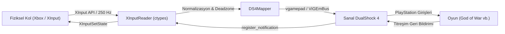

# DualShock 4 Controller Bridge 🎮

[](https://microsoft.com)
[](https://python.org)
[](https://github.com/nefarius/ViGEmBus)
[](https://opensource.org/licenses/MIT)

**DualShock 4 Controller Bridge**, fiziksel XInput (Xbox Series X/S, Xbox One veya XInput uyumlu) oyun kollarını ultra düşük gecikmeyle sanal bir **Sony DualShock 4 (PlayStation 4)** kontrolcüsüne dönüştüren yüksek performanslı bir Windows köprüsüdür.

Bu sayede PC'de oynadığınız PlayStation kökenli oyunlar (**God of War**, *Marvel's Spider-Man*, *The Last of Us Part I*, *Ghost of Tsushima*, *Uncharted* vb.) kolunuzu gerçek bir DualShock 4 olarak tanır; ekranda Xbox tuşları yerine orijinal **PlayStation tuş simgeleri (⨉ Çarpı, ◯ Daire, ▢ Kare, △ Üçgen, L1/R1, L2/R2)** görüntülenir.

---

## ✨ Öne Çıkan Özellikler

- ⚡ **Ultra Düşük Gecikme & 250 Hz Sabit Pacing:**  
  Windows multimedya zamanlayıcısı (`timeBeginPeriod(1)`) ve mikrosaniye hassasiyetinde hibrit spin-wait ile tam 250 Hz (~4.0 ms) döngü süresinde sıfır gecikmeli aktarım.
- 📳 **Tam İki Yönlü Titreşim (Force Feedback / Rumble):**  
  Oyundan sanal DualShock 4'e gönderilen darbe, vuruş, rünik saldırı ve patlama titreşimleri ViGEm bildirim kanalıyla (`register_notification`) anında yakalanır ve fiziksel kolunuzun motorlarına aktarılır.
- 🗺️ **PlayStation Touchpad (Harita) Simülasyonu:**  
  Koldaki **Back (View / Select)** tuşuna basıldığında hem Share hem de **PS Touchpad Tıklaması** simüle edilir. Klavyeye dokunmadan harita ve menü doğrudan koldan açılır.
- 🎯 **Akıllı Oyun Algılama (Auto-Launch):**  
  Desteklenen bir PlayStation oyunu (*GodOfWar.exe*, *SpiderMan.exe* vb.) başladığında köprüyü otomatik aktif eder, oyun kapandığında uyku moduna geçerek işlemci ve pil tasarrufu sağlar.
- 🛡️ **Dahili HidHide Desteği (Çift Tuş Koruması):**  
  Fiziksel Xbox kolunu arka planda tek tıkla gizleyerek oyunlarda çift tuş basma (double input) ve simge çakışması sorunlarını engeller.
- 🎛️ **Profesyonel ve Sade Yönetim Paneli:**  
  Sade, göz yormayan arayüz. Analog çubukların canlı konumlarını 2D kanvasta gösterir, ölü bölgeyi (deadzone) ve titreşim gücünü ayarlamanızı sağlar.
- 🪟 **Sistem Tepsisi (System Tray) Entegrasyonu:**  
  Pencereyi kapattığınızda uygulama görev çubuğu bildirim alanına (saat yanına) küçülür, oyununuzu bölmeden arka planda sessizce çalışır.

---

## 🎯 Test Edilmiş ve Desteklenen Oyunlar

| Oyun | PlayStation Tuş Simgeleri | İki Yönlü Titreşim | Koldan Harita (Touchpad) |
| :--- | :---: | :---: | :---: |
| **God of War (2018)** | ✅ | ✅ | ✅ |
| **Marvel's Spider-Man Remastered / Miles Morales** | ✅ | ✅ | ✅ |
| **The Last of Us Part I** | ✅ | ✅ | ✅ |
| **Horizon Zero Dawn & Forbidden West** | ✅ | ✅ | ✅ |
| **Ghost of Tsushima** | ✅ | ✅ | ✅ |
| **Uncharted: Hırsızlar Mirası Koleksiyonu** | ✅ | ✅ | ✅ |
| **Returnal** | ✅ | ✅ | ✅ |
| **Detroit: Become Human** | ✅ | ✅ | ✅ |

---

## 🚀 Kurulum ve Başlangıç

### Yöntem 1: Hazır Kurulum Sihirbazı (Önerilen)
1. Projenin [Releases](../../releases) bölümünden **`DualShock4_Kurulum_Setup.exe`** dosyasını indirin.
2. Kurulumu tamamlayın.
3. Masaüstündeki **DualShock 4 Kontrol Merkezi** simgesini açın.

### Yöntem 2: Kaynak Koddan Çalıştırma
Projeyi klonlayıp kendi Python ortamınızda çalıştırmak için:

```bash
# Depoyu klonlayın
git clone https://github.com/MustafaEmirKocyigitt/DualShock4Bridge.git
cd DualShock4Bridge

# Gerekli bağımlılıkları yükleyin
pip install -r requirements.txt

# Kontrol merkezini başlatın
python main_gui.py
```

> **Gereksinim:** Sisteminizde [ViGEmBus](https://github.com/nefarius/ViGEmBus/releases/latest) sürücüsü kurulu olmalıdır.

---

## 🎮 God of War & Steam İçin Önemli İpucu

God of War'ı Steam üzerinden oynuyorsanız, Steam'in kendi kontrolcü arayüzü sanal PlayStation kolunu tekrar Xbox koluna çevirebilir. Bunu önlemek için:

1. Steam Kütüphanenizde **God of War** oyununa sağ tıklayın -> **Özellikler (Properties)** seçin.
2. Sol menüden **Kontrolcü (Controller)** sekmesine gelin.
3. Açılır menüden **"Steam Girdisini Devre Dışı Bırak" (Disable Steam Input)** seçeneğini işaretleyin.
4. Oyunu başlatın. Oyun doğrudan sanal DualShock 4'ü tanıyacak ve PlayStation tuş simgeleri aktifleşecektir!

---

## 🏗️ Mimari & Çalışma Mantığı



---

## ⚙️ Yapılandırma Seçenekleri (`config.json`)

Uygulama arayüzünden yapılan tüm ayarlar `config.json` dosyasına kaydedilir:

* `THUMB_DEADZONE` (Varsayılan: `0.06`): Analog çubukların merkezdeki hassasiyet boşluğu.
* `RUMBLE_STRENGTH` (Varsayılan: `1.0`): Titreşim gücü çarpanı (%0 - %200).
* `BACK_MAPPING_MODE` (Varsayılan: `"both"`): Back tuşunun Touchpad ve Share işlevleri.
* `AUTO_GAME_DETECT` (Varsayılan: `true`): Hedef oyun açıldığında otomatik başlama.

---

## 📄 Lisans

Bu proje [MIT Lisansı](LICENSE) kapsamında açık kaynak olarak sunulmaktadır.
Dilediğiniz gibi kullanabilir, geliştirebilir ve paylaşabilirsiniz.

---

## ⚖️ Yasal Uyarı & Marka Feragatnamesi (Disclaimer)

Bu proje bağımsız bir açık kaynak yazılımıdır ve **Sony Interactive Entertainment Inc.** veya **Microsoft Corporation** ile hiçbir resmi bağı, sponsorluğu veya onayı bulunmamaktadır. 

* "PlayStation", "DualShock", "DualSense", "PS4", "PS5" ifadeleri Sony Interactive Entertainment Inc. şirketinin tescilli ticari markalarıdır.
* "Xbox", "Xbox Series X/S", "Xbox One", "XInput" ifadeleri Microsoft Corporation şirketinin tescilli ticari markalarıdır.
* Dokümantasyonda adı geçen oyun isimleri ilgili stüdyo ve yayıncıların mülkiyetindedir.

Bu ticari markalar ve isimler bu depoda yalnızca **donanım uyumluluğunu, birlikte çalışabilirliği ve teknik işlevselliği** kullanıcılara açıklamak amacıyla referans (Nominative Fair Use) olarak kullanılmıştır.

