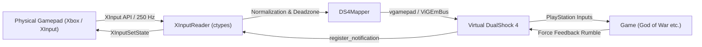

# DualShock 4 Controller Bridge 🎮

[ 🇹🇷 Türkçe Dokümantasyon için tıklayın ](README.tr.md)

[](https://microsoft.com)
[](https://python.org)
[](https://github.com/nefarius/ViGEmBus)
[](https://opensource.org/licenses/MIT)

**DualShock 4 Controller Bridge** is a high-performance Windows application that transparently maps physical XInput controllers (Xbox Series X/S, Xbox One, or compatible gamepads) to a virtual **Sony DualShock 4 (PlayStation 4)** controller with ultra-low latency.

This enables PC games ported from PlayStation (**God of War**, *Marvel's Spider-Man*, *The Last of Us Part I*, *Ghost of Tsushima*, *Uncharted*, etc.) to natively detect your controller as an authentic DualShock 4, displaying original **PlayStation button glyphs (⨉ Cross, ◯ Circle, ▢ Square, △ Triangle, L1/R1, L2/R2)** instead of Xbox ABXY prompts.

---

## ✨ Key Features

- ⚡ **Ultra-Low Latency & 250 Hz Polling Rate:**  
  Leverages Windows high-resolution multimedia timers (`timeBeginPeriod(1)`) and hybrid spin-wait loops for a steady ~4.0 ms cycle with zero perceived input lag.
- 📳 **Full Bidirectional Force Feedback (Rumble):**  
  Intercepts rumble commands sent by games to the virtual DualShock 4 via ViGEm notifications (`register_notification`) and immediately relays them to physical controller vibration motors.
- 🗺️ **PlayStation Touchpad (Map) Simulation:**  
  Pressing the Xbox **Back (View)** button simultaneously triggers the DualShock 4 **Touchpad Click** and Share button. Open maps, journals, and menus directly from your controller without reaching for your keyboard.
- 🎯 **Smart Game Detection (Auto-Launch):**  
  Background process monitor automatically activates the bridge when a supported title (*GodOfWar.exe*, *SpiderMan.exe*, etc.) launches, and enters sleep mode when closed to conserve CPU cycles.
- 🛡️ **Built-in HidHide Integration (Anti Double-Input):**  
  Directly interfaces with Nefarius HidHide to cloak the physical Xbox controller from games with a single toggle, preventing double-input glitches and conflicting glyphs.
- 🌐 **Bilingual Interface (English & Turkish):**  
  Seamlessly switch languages anytime via the instant language toggle button in the header.
- 🎛️ **Clean & Distraction-Free Control Panel:**  
  Minimalist, anti-pattern-compliant UI. Visualizes live analog stick positions on 2D circular canvases, lets you calibrate deadzones, test rumble, and adjust vibration intensity.
- 🪟 **System Tray Integration:**  
  Closing the window minimizes the app to the Windows notification tray (near the taskbar clock), running uninterrupted in the background while you play.

---

## 🎯 Verified & Supported Games

| Game | PlayStation Glyphs | Rumble Feedback | In-Game Map via Touchpad |
| :--- | :---: | :---: | :---: |
| **God of War (2018)** | ✅ | ✅ | ✅ |
| **Marvel's Spider-Man Remastered & Miles Morales** | ✅ | ✅ | ✅ |
| **The Last of Us Part I** | ✅ | ✅ | ✅ |
| **Horizon Zero Dawn & Forbidden West** | ✅ | ✅ | ✅ |
| **Ghost of Tsushima** | ✅ | ✅ | ✅ |
| **Uncharted: Legacy of Thieves Collection** | ✅ | ✅ | ✅ |
| **Returnal** | ✅ | ✅ | ✅ |
| **Detroit: Become Human** | ✅ | ✅ | ✅ |

---

## 🚀 Getting Started

### Option 1: Official Windows Installer (Recommended)
1. Download the installer directly from this repository:  
   👉 **[📥 Download DualShock4_Kurulum_Setup.exe](setup/DualShock4_Kurulum_Setup.exe?raw=true)** *(Included in the `setup/` folder)*
2. Run the setup wizard and complete the installation.
3. Launch **DualShock 4 Control Center** from your Desktop or Start Menu.

*(If you already cloned the repository, you can simply run **`kurulum.bat`**).*

### Option 2: Run from Source
Clone and run directly in your Python environment:

```bash
# Clone the repository
git clone https://github.com/MustafaEmirKocyigitt/DualShock4Bridge.git
cd DualShock4Bridge

# Install dependencies
pip install -r requirements.txt

# Run the control center
python main_gui.py
```

> **Prerequisite:** [ViGEmBus driver](https://github.com/nefarius/ViGEmBus/releases/latest) must be installed on your Windows system.

---

## 🎮 Important Tip for God of War & Steam Users

If you are playing God of War on Steam, Steam's built-in controller overlay might intercept the virtual DualShock 4 and translate it back to an Xbox controller. To resolve this:

1. In your Steam Library, right-click **God of War** -> select **Properties**.
2. Click the **Controller** tab on the left.
3. In the dropdown, select **"Disable Steam Input"**.
4. Launch the game. God of War will now communicate directly with the virtual DualShock 4 and native PlayStation button glyphs (▢, △, ◯, ⨉) will appear on screen!

---

## 🏗️ Architecture & Data Flow



---

## ⚙️ Configuration Parameters (`config.json`)

All configuration options are stored persistently in `config.json`:

* `THUMB_DEADZONE` (Default: `0.06`): Radial deadzone threshold for thumbsticks (%0 to %20).
* `RUMBLE_STRENGTH` (Default: `1.0`): Multiplier for force feedback vibration (0.0x to 2.0x).
* `BACK_MAPPING_MODE` (Default: `"both"`): Action for the Back button (`"both"`, `"touchpad"`, or `"share"`).
* `AUTO_GAME_DETECT` (Default: `true`): Automatically activate bridge when supported titles launch.
* `LANGUAGE` (Default: `"en"`): Interface language (`"en"` or `"tr"`).

---

## 📄 License

This project is licensed under the [MIT License](LICENSE).
You are free to use, modify, and distribute it.

---

## ⚖️ Legal Disclaimer & Trademark Notice

This project is an independent open-source utility and is **not affiliated with, sponsored, or endorsed by Sony Interactive Entertainment Inc. or Microsoft Corporation**.

* "PlayStation", "DualShock", "DualSense", "PS4", and "PS5" are registered trademarks of Sony Interactive Entertainment Inc.
* "Xbox", "Xbox Series X/S", "Xbox One", and "XInput" are registered trademarks of Microsoft Corporation.
* All game titles, logos, and brands mentioned are the property of their respective owners.

All trademarks and brand names are used strictly for **identification, compatibility, and technical interoperability purposes only** under Nominative Fair Use principles.
